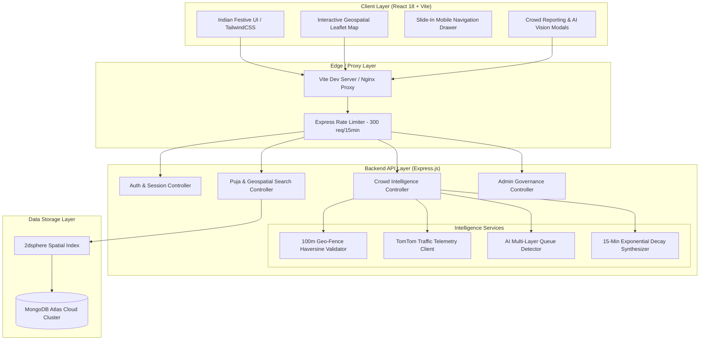

# 📋 Product Requirements Document (PRD)

## PandalGo — Festival Discovery & Real-Time Multi-Layer AI Crowd Intelligence Platform

**Document Version:** 1.0.0  
**Status:** Approved & Implemented  
**Target Event Horizon:** Durga Puja, Kali Puja & Jagaddhatri Puja (Bengal Sharodotsav)  
**Primary Region:** Kolkata Metropolitan Area & West Bengal  
**Repository:** `siddhartha2001dev/PandalGo`  

---

## 1. Executive Summary & Product Vision

### 1.1 Executive Summary
During West Bengal's Durga Puja (inscribed on the UNESCO Representative List of the Intangible Cultural Heritage of Humanity), over 10 million visitors take to the streets across Kolkata to visit hundreds of elaborately sculpted artistic pandals. However, visitors face extreme arterial congestion, 2-to-4 hour unannounced queue gridlocks, fragmented location details, and outdated social media reports.

**PandalGo** solves this challenge as a modern, high-performance web platform that pairs an interactive geospatial directory of 45+ verified iconic pandals with a **4-Tier Hybrid AI Crowd Intelligence Engine**. By fusing 100-meter geo-verified on-site visitor reports, live TomTom road speed telemetry, computer vision queue flow analysis, and 15-minute exponential decay scoring, PandalGo provides festival hoppers with actionable, verified, real-time wait times and corridor conditions.

### 1.2 Vision Statement
> *"To preserve and celebrate Bengal’s rich festive heritage through an authentic cultural digital experience, empowering every pandal hopper with verified spatial intelligence, zero-friction queue awareness, and community-driven safety."*

---

## 2. Problem Statement & User Personas

### 2.1 The Problem
1. **Unpredictable Pandal Queues:** Queue wait times swing wildly between 10 minutes and 3 hours within a span of 30 minutes without warning.
2. **False or Armchair Reports:** Social media apps are polluted with outdated or fake reports from users sitting miles away from the pandal.
3. **Severe Road & Pedestrian Congestion:** Arterial bottlenecks around major pandal complexes (e.g., Sreebhumi, Bagbazar, Suruchi Sangha) lead to complete traffic paralysis.
4. **Generic, Culturally Detached UIs:** Most discovery tools feature cold, corporate, stark-white designs that fail to convey the emotional warmth and visual artistry of Sharodotsav.

### 2.2 Target Personas

```text
+-----------------------+-----------------------+-----------------------+-----------------------+
|  The Hopper           |  The Family Planner   |  The Cultural Blogger |  The Committee Admin  |
+-----------------------+-----------------------+-----------------------+-----------------------+
| Souvik, 24            | Maitreyi, 42          | Ananya, 28            | Debashis, 51          |
| Fast-paced hopper.    | Navigating with kids  | Photography & story   | Puja organizer.       |
| Visits 10-15 pandals  | and elderly parents.  | enthusiast. Shares    | Needs accurate queue  |
| a night. Needs live   | Needs low-crowd hours,| high-res pandal art,  | flow, verified pins,  |
| wait times & traffic  | metro proximity, and  | reviews, and corridor | and public safety     |
| flow to route smart.  | accurate walking dist.| experiences.          | announcements.        |
+-----------------------+-----------------------+-----------------------+-----------------------+
```

---

## 3. Product Goals & Success Metrics (KPIs)

### 3.1 Business & Impact Goals
* **Pandal Discoverability:** 100% geographic coverage of Kolkata's Tier-1 and Tier-2 heritage and community Durga Pujas.
* **Accuracy of Crowd Estimates:** >85% correlation between PandalGo estimated wait times and physical on-site ground truth.
* **Anti-Fraud Integrity:** 0% remote armchair crowd reports accepted into the live computation engine.

### 3.2 Product KPIs
| Metric | Target | Measurement Method |
|---|---|---|
| **Geo-Fencing Compliance** | 100% of community crowd reports verified within 100m | Server-side Haversine validation |
| **Crowd Decay Freshness** | Reports older than 15 min decayed automatically | Exponential decay half-life engine |
| **Page Speed & Map Latency** | First Contentful Paint < 1.2s; Map Pan 60 FPS | Lighthouse audit & Leaflet canvas rendering |
| **Mobile Usage Split** | >80% traffic optimized for mobile view | Responsive layout with dedicated drawer |

---

## 4. System Architecture & High-Level Topology



---

## 5. Functional Requirements (FR)

### FR-1: Geospatial Interactive Map & Discovery Engine
* **FR-1.1:** The platform must display an interactive Leaflet map featuring custom SVG pandal markers color-coded by real-time crowd status:
  * 🟢 **Low Crowd:** Green halo (~5–15 min queue).
  * 🟡 **Moderate Crowd:** Amber halo (~20–35 min queue).
  * 🔴 **Heavy Queue:** Red pulsing halo (~45–90+ min queue).
  * 🟣 **Mixed / Fluctuating:** Purple halo (rapid influx).
  * ⚪ **Unknown / Decayed:** Neutral stone halo (insufficient fresh data).
* **FR-1.2:** The map must feature real-time user geolocation tracking, displaying a high-accuracy GPS radar circle with heading accuracy.
* **FR-1.3:** Pandal directory must support multi-facet filtering:
  * By Locality: *North Kolkata, South Kolkata, Central Kolkata, Salt Lake, Behala, East Kolkata*.
  * By Category: *Heritage / Bonedi Bari, Big Budget, Eco-Friendly, Theme-Based*.
  * By Live Crowd: *All, Low Wait, Moderate, Heavy Queue*.
* **FR-1.4 (Responsive View Separation):**
  * **Desktop / PC View (`lg+`):** The pandal directory list and interactive map must render side-by-side simultaneously. The `Pandals | Live Map` segmented switcher is completely hidden on PC view.
  * **Mobile / Tablet View (`<lg`):** A dedicated segmented tab switcher (`Pandals (N)` vs `Live Map`) toggles between single-pane viewports with full touch optimization.

### FR-2: 4-Tier Hybrid AI Crowd Intelligence Engine
* **FR-2.1 (Tier 1: 100m Geo-Fenced Proximity Validation):**
  * When a visitor submits a crowd observation, their device GPS coordinates are transmitted and verified against the pandal’s registered coordinates using the spherical Haversine formula:
    $$d = 2R \arcsin\left(\sqrt{\sin^2\left(\frac{\Delta \phi}{2}\right) + \cos(\phi_1)\cos(\phi_2)\sin^2\left(\frac{\Delta \lambda}{2}\right)}\right)$$
  * If $d > 100\text{ meters}$, the submission is rejected with HTTP 403 (*"You must be within 100 meters of the pandal to submit a verified crowd report"*).
* **FR-2.2 (Tier 2: Real-Time Traffic Corridor Telemetry):**
  * The backend queries TomTom’s Real-Time Traffic Flow API around the pandal’s spatial coordinates within a 500m bounding corridor.
  * Evaluates current speed vs free-flow speed to calculate road congestion factor ($C_{traffic} = 1 - \frac{v_{current}}{v_{freeflow}}$).
  * Heavy road delays elevate the baseline crowd expectation.
* **FR-2.3 (Tier 3: AI Computer Vision Queue Analysis):**
  * Evaluates pandal approach photos and corridor media using multi-stage feature extraction:
    * Pedestrian head contour clustering.
    * Edge density tracking along barricade queue channels.
    * Movement flow heuristics.
  * Outputs an algorithmic crowd level (`low`, `moderate`, `heavy`), estimated wait time (minutes), and a confidence score ($0.0 - 1.0$).
* **FR-2.4 (Tier 4: Multi-Signal Temporal Decay & Synthesis):**
  * Fresh observations within 0–5 minutes carry a weight factor of $1.0$.
  * Weight decays exponentially over 15 minutes:
    $$W(t) = e^{-\lambda t}, \quad \text{where } \lambda = \frac{\ln(2)}{t_{half}}$$
  * Observations older than 15 minutes are discarded from active computation, causing the pandal to cleanly revert to baseline status.

### FR-3: Community Media Feed & Traceable Stories
* **FR-3.1:** Users can publish festive experiences, reviews, and photos linked to specific pandals.
* **FR-3.2:** Every post card displays a dynamic badge showing the pandal's current crowd status and number of verified reports within 100m.
* **FR-3.3 (Trace on Map):** Clicking "Trace on Map" navigates to the home map, smoothly centers on the pandal coordinates, highlights the marker with a festive ring, and displays the pandal card.
* **FR-3.4 (Google Maps Navigation):** One-tap button opens external Google Maps turn-by-turn navigation with exact coordinates.

### FR-4: Anti-Fake Pandal Creation Security
* **FR-4.1:** Normal users can only register pandals at their **verified current GPS position**. Manual remote pin placement is restricted to prevent malicious phantom pandals.
* **FR-4.2:** Once submitted with verified coordinates, the pandal goes live immediately for discovery across the community.

### FR-5: Protected Admin Governance Portal
* **FR-5.1:** Accessible at `/admin`, protected via frontend route guards and backend role-based middleware (`verifyToken` + `requireAdmin`).
* **FR-5.2:** Admins have exclusive permission to:
  * Drop custom pins anywhere on the map or input arbitrary coordinates.
  * Synchronize verified Kolkata pandal datasets with exact metro connectivity.
  * Approve, modify, or remove user-submitted pandals.
  * View platform-wide telemetry, user registrations, and observation frequency.

### FR-6: Indian Festive Cultural UI/UX Design System
* **FR-6.1 (Color Tokens):**
  * *Kash Phool Cream:* `#FDFBF7` (Light background) / `#1E1A17` (Dark background)
  * *Terracotta Red:* `#C74732` (Primary CTA and cultural accent)
  * *Sindoor Crimson:* `#991B1B` (Interactive hover & alert highlights)
  * *Utsab Amber:* `#D97706` / Brass `#D4AF37` (Mandalas, stars, and badges)
  * *Alpana Border:* `#E8DEC8` (Subtle ornamental separators)
* **FR-6.2 (Mobile Navigation Drawer):**
  * The hamburger menu opens a full-height slide-in drawer from the right screen edge with backdrop blur (`backdrop-blur-md`).
  * Features culturally styled navigation links, theme toggle, and auth actions.
* **FR-6.3 (Festive Scanning Animation):**
  * The AI Crowd Detection modal features an animated radar scanner with glowing concentric circles, mandala reticles, and live telemetry badges.

---

## 6. Data Model & Schema Specifications

### 6.1 Puja (Pandal) Schema
```javascript
{
  name: { type: String, required: true },
  slug: { type: String, unique: true },
  description: { type: String },
  locality: { type: String, required: true }, // e.g., 'North Kolkata'
  address: { type: String },
  location: {
    type: { type: String, enum: ['Point'], default: 'Point' },
    coordinates: { type: [Number], required: true }, // [longitude, latitude]
  },
  category: { type: String, enum: ['Heritage', 'Theme', 'Community', 'Eco-Friendly'] },
  images: [{ type: String }],
  nearestMetro: { type: String },
  zone: { type: String },
  isApproved: { type: Boolean, default: true },
  currentCrowdStatus: { 
    type: String, 
    enum: ['low', 'moderate', 'high', 'mixed', 'unknown'], 
    default: 'unknown' 
  },
  estimatedWaitMinutes: { type: Number, default: 0 },
  lastCrowdUpdate: { type: Date, default: null }
}
// Index: { location: '2dsphere' }
```

### 6.2 Crowd Observation Schema
```javascript
{
  pujaId: { type: ObjectId, ref: 'Puja', required: true },
  userId: { type: ObjectId, ref: 'User', required: true },
  crowdLevel: { type: String, enum: ['low', 'moderate', 'high'], required: true },
  estimatedWaitMinutes: { type: Number, required: true },
  coordinates: {
    type: { type: String, enum: ['Point'], default: 'Point' },
    coordinates: { type: [Number], required: true } // [longitude, latitude]
  },
  distanceMeters: { type: Number, required: true }, // Must be <= 100m
  source: { type: String, enum: ['gps', 'vision_ai', 'manual'], default: 'gps' },
  imageReference: { type: String },
  createdAt: { type: Date, default: Date.now, index: { expires: '24h' } }
}
// Index: { pujaId: 1, createdAt: -1 }
```

---

## 7. Non-Functional Requirements (NFR)

* **NFR-1 (Performance):** Geospatial index queries (`$near` / `$geoNear`) must execute in under 30ms for 100+ concurrent requests.
* **NFR-2 (Resilience & Fallbacks):** If TomTom API or AI Vision services experience downtime, the system falls back gracefully to on-site crowd reports and historical averages without crashing.
* **NFR-3 (Data Privacy):** User GPS coordinates are used exclusively for on-site distance calculations and are never shared or sold to third-party ad networks.
* **NFR-4 (Accessibility & A11y):** All interactive buttons and navigation controls include descriptive ARIA labels, minimum touch targets of 44×44px, and meet WCAG AA contrast standards across both light and dark modes.

---

## 8. Release Roadmap

### Phase 1: V1.0 Launch (Current)
* ✅ 45+ Verified Kolkata Durga Puja Pandals seeded on MongoDB Atlas.
* ✅ 4-Tier Hybrid AI Crowd Intelligence Engine active.
* ✅ 100-Meter Geo-Fencing verification strictly enforced.
* ✅ Responsive desktop split-view & mobile slide-in navigation drawer.
* ✅ Protected Admin Portal with live dataset synchronization.

### Phase 2: V1.1 Festive Expansions (Upcoming)
* ⏳ **Kali Puja Expansion:** Unlock Barasat, Naihati, and Central Kolkata Kali Puja pandals.
* ⏳ **Jagaddhatri Puja Expansion:** Unlock Chandannagar, Bhadreswar, and Rishra heritage lighting & pandal circuits.
* ⏳ **Offline PWA Support:** Service worker tile caching for areas with cellular congestion.
* ⏳ **Smart Route Itinerary Planner:** Optimized multi-pandal walking routes minimizing queue delays.

---

**Approval Signoff:** Product Engineering Team • PandalGo  
**Document Repository:** `d:\OneDrive\Desktop\pujoMap\PRD.md`
