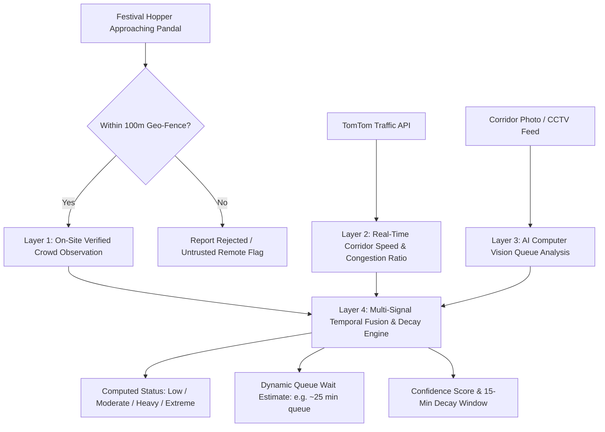

# 🪔 PandalGo — Discover Bengal's Festive Heritage with Live AI Crowd Intelligence

[](https://nodejs.org/)
[](https://react.dev/)
[](https://www.mongodb.com/cloud/atlas)
[](https://tailwindcss.com/)
[](https://developer.tomtom.com/)
[](LICENSE)

**PandalGo** is an Indian cultural geospatial web platform engineered for **Durga Puja discovery, real-time pandal navigation, and multi-layer AI crowd intelligence** across Kolkata and West Bengal. It combines interactive mapping, 100-meter geo-verified community reports, real-time arterial traffic telemetry, and computer vision queue flow analysis to help millions of festival hoppers navigate queues effortlessly.

---

## 🌟 Key Highlights

* **🗺️ 45+ Pre-Seeded Kolkata Pandals:** Authentic cultural showcase covering North Kolkata, South Kolkata, Central, Salt Lake, Behala, and East Kolkata with coordinates, descriptions, nearest metro stations, and cultural imagery.
* **🧠 4-Tier Hybrid AI Crowd Intelligence Engine:** Merges 100m on-site GPS verification, TomTom live traffic corridor speeds, AI vision queue density estimations, and dynamic 15-minute exponential decay.
* **🎨 Indian Festive & Cultural Visual Identity:** Rooted in Bengal's autumnal *Sharodotsav* heritage—Kash phool cream backgrounds, terracotta reds, vermilion orange accents, intricate alpana border motifs, dark/light cultural modes, and responsive side-drawer navigation.
* **📍 100-Meter Geo-Fenced Verification:** Enforces a strict 100m radius threshold for on-site crowd reporting, eliminating false reports from armchair users while empowering genuine visitors at the pandal gate.
* **☁️ Cloud-Native MongoDB Atlas:** Production-grade cloud database with `2dsphere` geospatial indices, fast proximity queries (`$near`), and high-availability replica sets.
* **📱 Adaptive Responsive Layout:** Desktop features a high-productivity split view (pandal directory list + real-time interactive map), while mobile devices switch seamlessly via a dedicated mobile tab bar and smooth slide-in navigation drawer.

---

## 🧠 4-Tier AI Crowd Intelligence Architecture

PandalGo does not rely on a single data point. It synthesizes real-world signals across four distinct layers to compute an accurate, tamper-resistant crowd estimate:



### Layer Breakdown

1. **Layer 1: On-Site 100m Geo-Fence Verification**  
   Users submitting queue reports must prove physical proximity. Using browser device GPS, coordinates are validated via Haversine spherical distance against the pandal's exact gate coordinates. Observations outside **100 meters** are automatically rejected.
2. **Layer 2: Live TomTom Corridor Traffic Telemetry**  
   PandalGo queries TomTom's Real-Time Traffic Flow API in real time around the pandal's latitude/longitude. It tracks live road speed vs free-flow speed, road closure flags, and arterial traffic delay to anticipate bottleneck arrivals.
3. **Layer 3: Multi-Layer AI Computer Vision Queue Detection**  
   Evaluates pandal approach photos using multi-stage feature extraction, pedestrian head density clustering, edge contour tracking, and queue line flow heuristics. Estimates crowd density level and queue wait duration with up to 90%+ confidence.
4. **Layer 4: Temporal Exponential Decay & Confidence Synthesis**  
   Observations older than 15 minutes are progressively decayed. A time-weighted decaying moving average ensures that fresh observations heavily dictate the current badge, while stale observations gracefully transition back to baseline.

---

## 🛠️ Technology Stack

| Layer | Technologies | Description |
|---|---|---|
| **Frontend Framework** | React 18, Vite | High-performance SPA with fast hot module replacement |
| **Styling & Design System** | Tailwind CSS v3.4, Vanilla CSS | Bespoke Indian cultural theme tokens, glassmorphism, responsive utilities |
| **Geospatial & Mapping** | Leaflet, React-Leaflet, OpenStreetMap | Interactive tile rendering, custom SVG pandal pins, user GPS radar halos |
| **State & Data Fetching** | TanStack Query v5 (React Query) | Intelligent caching, automatic refetching, background polling |
| **Icons & Media** | Lucide React | Modern featherweight stroke icons |
| **Backend Runtime** | Node.js (v18+), Express.js | Modular RESTful API v1 with tiered middleware |
| **Cloud Database** | MongoDB Atlas | Cloud-hosted NoSQL cluster with `2dsphere` spatial indexing |
| **Validation & Security** | Zod, Helmet, Express Rate Limit, bcryptjs, JWT | Strict runtime validation, CSRF/XSS protection, rate limiting |
| **External APIs** | TomTom Traffic Flow API, OpenStreetMap Nominatim | Real-time traffic congestion telemetry and reverse geocoding |

---

## 📁 Repository Structure

```text
pujoMap/
├── client/                           # Frontend React + Vite application
│   ├── public/                       # Static branding, favicon, cultural motifs
│   ├── src/
│   │   ├── components/               # UI Component Hierarchy
│   │   │   ├── common/               # Header, Footer, ThemeToggle, Modal, CrowdBadge
│   │   │   ├── crowd/                # CrowdReportModal, AutoCrowdDetectModal
│   │   │   ├── map/                  # PujoMap, LocationPickerMap
│   │   │   ├── pandals/              # PujaCard, FilterControls
│   │   │   └── posts/                # PostCard, CommentSection
│   │   ├── context/                  # AuthContext, ThemeContext
│   │   ├── lib/                      # Axios API client & interceptors
│   │   ├── pages/                    # HomePage, PandalDetailPage, CommunityFeedPage,
│   │   │                             # CreatePostPage, AddPujaPage, ProfilePage,
│   │   │                             # AdminDashboardPage, LoginPage, RegisterPage
│   │   ├── App.jsx                   # Application router & protected routes
│   │   ├── index.css                 # Cultural theme tokens & responsive styles
│   │   └── main.jsx                  # React entry point
│   ├── package.json
│   ├── tailwind.config.js            # Custom color palette & breakpoints
│   └── vite.config.js                # Build config & local reverse proxy
├── server/                           # Backend Express API & Services
│   ├── scripts/                      # DB utilities (seed-atlas, clean-dummy, admin)
│   ├── src/
│   │   ├── config/                   # MongoDB Atlas connection & env loader
│   │   ├── controllers/              # Auth, Puja, Post, Crowd, Admin, Upload
│   │   ├── middleware/               # Auth, Zod validation, error handler, rate limiter
│   │   ├── models/                   # User, Puja, Post, CrowdObservation
│   │   ├── routes/                   # REST API routes (/api/v1/*)
│   │   ├── services/                 # Crowd fusion service, TomTom traffic, vision
│   │   ├── validators/               # Zod schemas for all endpoints
│   │   ├── app.js                    # Express app configuration
│   │   └── server.js                 # HTTP listener entrypoint
│   ├── .env                          # Server environment configuration
│   └── package.json
├── PRD.md                            # Complete Product Requirements Document
├── package.json                      # Workspace root scripts
└── README.md                         # Project documentation
```

---

## 🚀 Quick Start & Installation

### 1. Prerequisites
* **Node.js**: v18.0.0 or higher
* **npm**: v9.0.0 or higher
* **MongoDB**: MongoDB Atlas Cloud account or local MongoDB 6+

### 2. Clone and Install Dependencies

```bash
# Clone the repository
git clone https://github.com/siddhartha2001dev/PandalGo.git
cd PandalGo

# Install all dependencies (root, backend, and frontend)
npm install
npm --prefix server install
npm --prefix client install
```

### 3. Environment Configuration

Create or configure `server/.env`:

```ini
PORT=5000
NODE_ENV=development
CLIENT_URL=http://localhost:5173
JWT_SECRET=pandalgo-festive-secret-key-2026-prod
ACCESS_TOKEN_EXPIRES_IN=15m
REFRESH_TOKEN_EXPIRES_IN=30d
REFRESH_TOKEN_DAYS=30

# MongoDB Atlas Connection URI
MONGODB_URI=mongodb+srv://<username>:<password>@<cluster>.mongodb.net/pandalgo?retryWrites=true&w=majority

# Crowd Intelligence Parameters
CROWD_RADIUS_METERS=100
CROWD_FRESHNESS_MINUTES=15
CROWD_REPORT_COOLDOWN_MINUTES=3

# External Traffic Telemetry (Optional TomTom API Key)
TOMTOM_API_KEY=your_tomtom_api_key_here
```

The included Vercel rewrite proxies `/api` to `https://pandalgo-y5tm.onrender.com`, so `VITE_API_URL` can remain unset. The current deployed frontend origin is `https://pandal-csa0noeky-sidcode1.vercel.app`; configure that exact value as Render's `CLIENT_URL`. If you deploy without the rewrite, set `VITE_API_URL` to `https://pandalgo-y5tm.onrender.com`. In MongoDB Atlas, allow the Render service network access and seed the connected database with `npm --prefix server run seed` once.

### 4. Seed 45+ Verified Kolkata Pandals

To populate your MongoDB Atlas cluster with the complete catalog of Kolkata's famous pandals (Bagbazar, College Square, Mohammad Ali Park, Suruchi Sangha, Maddox Square, Chetla Agrani, Sreebhumi, etc.):

```bash
npm --prefix server run seed
```

### 5. Create an Administrator Account

Run the dedicated administrative provisioning script:

```bash
npm run create-admin
```
Follow the interactive prompts to define your admin email, display name, and secure password.

### 6. Launch Development Environment

Run both the server and client concurrently:

```bash
npm run dev
```

* **Frontend Web App:** [http://localhost:5173](http://localhost:5173)
* **Backend API Base:** [http://localhost:5000/api/v1](http://localhost:5000/api/v1)
* **API Health Check:** [http://localhost:5000/api/health](http://localhost:5000/api/health)

---

## 📡 REST API Reference

All primary endpoints are hosted under `/api/v1`:

### 🔐 Authentication & Accounts
| Method | Endpoint | Access | Description |
|---|---|---|---|
| `POST` | `/api/v1/auth/register` | Public | Register new user account |
| `POST` | `/api/v1/auth/login` | Public | Authenticate user (returns JWT & sets HTTP-only cookie) |
| `POST` | `/api/v1/auth/logout` | Authenticated | Clear session cookie |
| `GET` | `/api/v1/auth/me` | Authenticated | Fetch authenticated user profile |

### 🪔 Pandals & Geospatial Discovery
| Method | Endpoint | Access | Description |
|---|---|---|---|
| `GET` | `/api/v1/pujas` | Public | Query pandals with locality, category, and GPS `$near` sorting |
| `GET` | `/api/v1/pujas/slug/:slug` | Public | Fetch comprehensive pandal details, gallery, and crowd status |
| `GET` | `/api/v1/pujas/geocode-location`| Public | Geocode search query via OpenStreetMap |
| `POST` | `/api/v1/pujas` | Authenticated | Register new pandal (strictly locked to device GPS for non-admins) |

### 👥 Crowd Intelligence & Queue Telemetry
| Method | Endpoint | Access | Description |
|---|---|---|---|
| `GET` | `/api/v1/pujas/:id/crowd` | Public | Fetch multi-signal crowd estimate and 15-min history |
| `POST` | `/api/v1/pujas/:id/crowd-reports` | Authenticated | Submit crowd observation (enforces 100m geo-fence) |
| `POST` | `/api/v1/pujas/:id/auto-crowd-detect` | Public/Auth | Trigger multi-layer AI vision & TomTom traffic scan |

### 📸 Community Posts & Feed
| Method | Endpoint | Access | Description |
|---|---|---|---|
| `GET` | `/api/v1/posts` | Public | Retrieve paginated community stories with live crowd badges |
| `POST` | `/api/v1/posts` | Authenticated | Create photo post with linked pandal location |
| `POST` | `/api/v1/posts/:id/like` | Authenticated | Like / unlike post |
| `POST` | `/api/v1/posts/:id/comments` | Authenticated | Post comment on community story |

### 🛡️ Admin Management Portal
| Method | Endpoint | Access | Description |
|---|---|---|---|
| `GET` | `/api/v1/admin/stats` | Admin Only | Platform statistics, observation counts, and user metrics |
| `GET` | `/api/v1/admin/pujas` | Admin Only | List all pandals with approval status and management actions |
| `PUT` | `/api/v1/admin/pujas/:id/approve` | Admin Only | Approve / verify submitted community pandal |
| `DELETE`| `/api/v1/admin/pujas/:id` | Admin Only | Remove duplicate or outdated pandal entry |

---

## 🔒 Security & Verification Model

1. **Anti-Fake Pandal Protection:** Community users cannot place arbitrary map pins across the city. The client automatically reads device GPS coordinates; if user coordinates differ from submitted pin locations, submission is rejected.
2. **100-Meter Geo-Fencing:** Crowd reports cannot be submitted remotely. A user must stand within 100 meters of the pandal to influence live wait time estimates.
3. **Protected Admin Portal:** The `/admin` route is guarded on both the frontend React router level (via `ProtectedRoute`) and the backend API controller level (`verifyToken` + `requireAdmin`).
4. **Rate Limiting & Input Sanitization:** Protected against brute force via Express Rate Limiting (300 requests / 15 minutes) and strict Zod schema parsing.

---

## 🎨 Cultural Design System

PandalGo's visual design honors the UNESCO-inscribed Intangible Cultural Heritage of Durga Puja:

* **Shondhi Shonar / Kash Phool (`#FDFBF7` / `#F4EBDD`):** Autumn cream tones inspired by Bengal's flowering kash grass and festive morning skies.
* **Sindoor & Terracotta (`#C74732` / `#991B1B`):** Deep crimson and earthen terracotta reflecting historic Bishnupur temples and vermilion festive rituals.
* **Utsab Amber (`#D97706` / `#D4AF37`):** Warm golden dhunuchi and brass bell glow.
* **Alpana Motif Linework:** Subtle geometric Indian floral borders on card frames and modal headers.
* **Fluid Slide-In Navigation Drawer:** Mobile menu slides smoothly from the right with glassmorphic backdrop and theme-aware contrast.

---

## 📄 License

This project is licensed under the MIT License — see the [LICENSE](LICENSE) file for details.

---

**Joy Maa Durga! • বাংলার দুর্গোৎসব ও ঐতিহ্য সবার জন্য**
