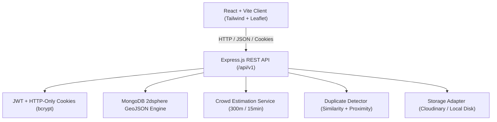

# PujoMap — Architecture Specification

## 1. Executive Summary

**PujoMap** is a full-stack Durga Puja discovery and community-sharing platform designed for festival visitors and pandal hoppers across West Bengal (including Kolkata, Naihati, Halisahar, Kalyani, Barrackpore, Ichhapur, and Sodepur).

The system is built on three core pillars:
1. **Pandal Discovery:** Geospatial map and list exploration of official, owner-verified pandals.
2. **Community Posts:** Visitor experiences, photographs, and observations published to an open feed.
3. **Crowd Intelligence:** Deterministic crowd estimation based on eligible on-site reports within a 300-meter radius over a 15-minute freshness window.

---

## 2. System Architecture

---

## 3. Strict Domain Model Separation

### 3.1 Community Post vs. Pandal Record
A crucial architectural invariant in PujoMap is that **a community post and an approved pandal are completely separate entities**:
* **Community Post (`Post`):** Represents an informal visitor contribution, photo, or impression. Anyone logged in can publish. It appears in the community feed. A post never creates an official approved pandal marker on the public map.
* **Pandal Record (`Puja`):** Represents an official, verified Durga Puja venue. New suggestions (`/contributions`) enter the system with `pending` status and are invisible to the public map until explicitly approved by the application owner.

### 3.2 Crowd Observation vs. Pandal Verification
* **Crowd Observation (`CrowdObservation`):** Time-sensitive crowd evidence (low, moderate, high) submitted by on-site hoppers. Submitting crowd data does **not** modify a pandal's approval state, nor can it convert a pending pandal into an approved one.

---

## 4. Deterministic Crowd Estimation Engine

PujoMap strictly avoids claiming that GPS alone reveals crowd density. Instead, it processes multi-source evidence with deterministic filtering:

1. **Geographic Filtering (300-Meter Radius):**
   - The registered pandal coordinates are treated as the epicenter.
   - Using MongoDB's `2dsphere` `$near` operator and spherical Haversine formulas, only observations recorded within **300 meters** are eligible.
   - Distant observations (e.g. commuters across town) are rejected by the server (`400 Bad Request`).

2. **Freshness Window (15 Minutes):**
   - Observations older than `CROWD_FRESHNESS_MINUTES` (default 15m) are excluded from the current density calculation.
   - If no observations exist within 15 minutes, the system returns `crowdStatus: 'unknown'` with `freshnessStatus: 'stale'` or `'no_data'`. The system **never** assumes missing data means "low crowd".

3. **Aggregation Logic:**
   - **Contributor Deduplication:** Only a user's most recent report in the 15-minute window is counted, preventing single-user spam from swaying the estimate.
   - **Consensus Threshold:** If >= 60% of eligible contributors report a specific level, that level is selected with `medium` or `high` confidence (if >= 3 independent contributors).
   - **Conflict Handling:** If there is substantial disagreement (e.g., equal low and high reports), the system honestly outputs `crowdStatus: 'mixed'`.
   - **Average Waiting Time:** Computed dynamically from reported queue waiting minutes.

---

## 5. Security & Privacy Architecture

* **Role-Based Access Control:** Two distinct roles:
  - `visitor`: Registered hoppers who can post, report crowds, and suggest pandals.
  - `admin`: The application owner. **Never** assignable through public registration; initialized strictly via `npm run create-admin` or secure backend CLI.
* **Authentication:**
  - Passwords hashed using `bcrypt` (10 salt rounds).
  - Sessions issued as signed JWT tokens delivered in secure, HTTP-only cookies (`SameSite: Lax` in development, `SameSite: None; Secure` in production) to prevent XSS credential theft.
* **Privacy Protections:**
  - User email addresses and raw high-precision GPS coordinates are never leaked in public feed or pandal responses.
  - GPS is requested only on-demand with explicit browser permissions (e.g., clicking "Pandals Near Me" or "Use Current Location").
* **Defense in Depth:**
  - `helmet` security headers.
  - `cors` origin restriction.
  - `express-rate-limit` on auth and crowd submissions.
  - Zod runtime request validation.
